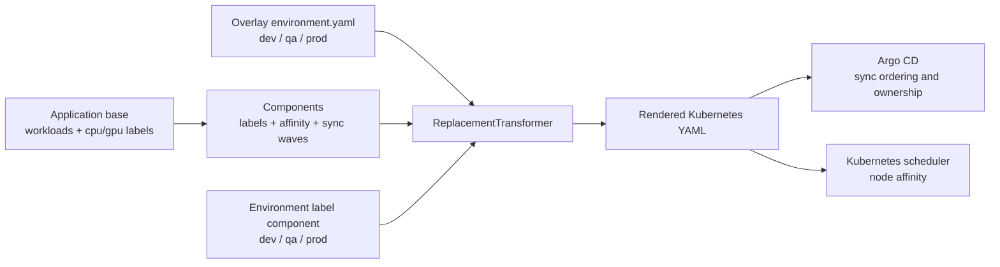

# Standards model architecture

This repository implements a reusable Kubernetes policy model with Kustomize 5.8.1.
It is not a machine-learning model: the model is the composition of workload
classification, shared Kustomize components, a late replacement transformer, and
environment-specific application overlays. The rendered YAML is the interface
consumed by Argo CD and the Kubernetes scheduler.

The design centralizes scheduling and deployment metadata without a separate
configuration file for every workload kind or resource name.

## What the model guarantees

For every supported workload, the final overlay produces:

- a required node-affinity expression for the selected cluster environment;
- a required node-affinity expression for the workload's `cpu` or `gpu` profile;
- standard `app.kubernetes.io/managed-by: argocd` metadata;
- an environment label such as `my.cluster/environment: qa`;
- a kind-specific Argo CD sync-wave annotation; and
- unchanged workload selectors and API versions.

The model also supports an opt-in StatefulSet rule that excludes nodes with
`scale.spectrum.ibm.com/role=afm`. It does not allocate GPU devices, change
container resources, or create Argo CD Applications.

## Repository layout

```text
kustomize-library/
  kustomization.yaml
  components/
    labels/
      argocd/
      environment/{dev,qa,prod}/
    node-affinity/
      kustomization.yaml
      scheduling-settings.yaml
    sync-waves/
      kustomization.yaml
      defaults.yaml
  transformers/
    node-affinity/
      kustomization.yaml
      transformer.yaml
```

`kustomize-library` is the reusable policy package. The example workloads and
the Minikube test live in
[kustomize-application](https://github.com/nick-draper/kustomize-application).
That repository's overlays select an environment and invoke the transformer.

## Build-time data flow

Kustomize evaluates the inputs in a composition pipeline. The transformer must
run in a final overlay, after the environment value and the affinity
placeholders exist.



### Stage 1: workload input

The example workloads live in `kustomize-application` under `base/resources/workload/`:

| Kind | Name | Profile | Affinity location |
| --- | --- | --- | --- |
| `Deployment` | `example-deployment` | `gpu` | `spec.template.spec` |
| `StatefulSet` | `example-statefulset-notin-afm` | `cpu` | `spec.template.spec` |
| `StatefulSet` | `example-statefulset-afm-allowed` | `cpu` | `spec.template.spec` |
| `Job` | `example-job` | `cpu` | `spec.template.spec` |
| `CronJob` | `example-cron-job` | `cpu` | `spec.jobTemplate.spec.template.spec` |

The profile is a top-level workload label:

```yaml
metadata:
  labels:
    scheduling.my.cluster/compute: cpu
```

The label is classification input. It is not a node selector, and the label
components do not copy it to the Pod template.

Every supported workload must have exactly one supported profile, `cpu` or
`gpu`. An omitted or unsupported value does not fail ordinary `kustomize build`;
it leaves `COMPUTE_PLACEHOLDER` in the output, which the application
`scripts/verify.sh` rejects with `kubectl` after Argo CD syncs.

### Stage 2: shared standard components

The application base applies the shared components explicitly:

1. `components/node-affinity`;
2. `components/labels/argocd`; and
3. `components/sync-waves`.

These are the same components aggregated by
`kustomize-library/kustomization.yaml`. Listing them at the application
boundary makes the base's policy layers visible.

#### Managed-by labels

`components/labels/argocd/kustomization.yaml` adds
`app.kubernetes.io/managed-by: argocd` to resource metadata and Pod templates.
The component sets `includeSelectors: false`, so Deployment, StatefulSet, and
Service selectors are not changed. It sets `includeTemplates: true`, so the
Pod template carries the same descriptive label.

#### Environment labels

The `dev`, `qa`, and `prod` components add
`my.cluster/environment: <environment>` using the same selector and template
rules. The `main` application overlay maps to the `prod` component and supplies
`environment: prod`.

Environment labels are metadata and do not themselves schedule a Pod. Scheduling
comes from the required node-affinity terms added by the node-affinity component.

#### Affinity scaffolding and build-only settings

`components/node-affinity/kustomization.yaml` adds the `scheduling-settings`
ConfigMap and patches the supported workload shapes. The patches create one
required node-selector term containing:

```yaml
matchExpressions:
  - key: my.cluster/environment
    operator: In
    values:
      - ENV_PLACEHOLDER
  - key: my.cluster/compute
    operator: In
    values:
      - COMPUTE_PLACEHOLDER
```

The ConfigMap is marked with `config.kubernetes.io/local-config: "true"`. It is
a build-time input and must not appear in the rendered manifests. The final
environment overlay patches `data.environment`. That is the only value the
ConfigMap supplies. CPU and GPU strings are `sourceValue` literals in the
transformer, not keys in this ConfigMap.

The component owns the required `nodeSelectorTerms` list for these workloads.
Additional shared required expressions belong in this component. Preferred
affinity and Pod affinity are outside this component and can be added by an
application when needed.

The Deployment, StatefulSet, and Job patch uses one combined target,
`kind: Deployment|StatefulSet|Job`. CronJob has its own patch because the
affinity lives under `spec.jobTemplate`.

#### Opt-in AFM exclusion

A StatefulSet with `scheduling.my.cluster/avoid-afm: "true"` selects a second
patch. That patch adds:

```yaml
- key: scale.spectrum.ibm.com/role
  operator: NotIn
  values:
    - afm
```

`example-statefulset-notin-afm` uses this opt-in.
`example-statefulset-afm-allowed` omits the label and receives only the
environment and compute expressions.

#### Sync-wave defaults

`components/sync-waves/defaults.yaml` contains built-in
`AnnotationsTransformer` definitions. Each definition targets resource metadata,
not Pod-template metadata. The imported policy assigns waves to 45 Kubernetes
and platform kinds. The application kinds used by the example are:

| Kind | Wave |
| --- | ---: |
| `Deployment` | `70` |
| `StatefulSet` | `70` |
| `Job` | `76` |
| `CronJob` | `78` |

The complete imported table is listed in
`kustomize-library/README.md`. These are organizational defaults, not a
universal dependency graph. A migration Job may need an explicit earlier wave
or an Argo CD hook.

An application overlay can override a default with an ordinary resource-shaped
patch. The published example does not include a separate override fixture.

### Stage 3: late replacement transformer

`transformers/node-affinity/transformer.yaml` is a Kustomize
`ReplacementTransformer` with three replacement rules. This is the Kustomize
5.8.1 form:

1. Read `data.environment` from the `scheduling-settings` ConfigMap and replace
   `ENV_PLACEHOLDER` for every supported workload.
2. Select workloads labeled `scheduling.my.cluster/compute=cpu` and replace
   `COMPUTE_PLACEHOLDER` with `sourceValue: cpu`.
3. Select workloads labeled `scheduling.my.cluster/compute=gpu` and replace
   `COMPUTE_PLACEHOLDER` with `sourceValue: gpu`.

Deployment, StatefulSet, and Job are one target:

```yaml
select:
  kind: Deployment|StatefulSet|Job
```

CronJob is a second target on each rule because its field path is
`spec.jobTemplate.spec.template.spec...`. That split is the PodSpec shape, not
a compatibility workaround. Kustomize 5.8.1 anchors a combined kind as
`^(?:Deployment|StatefulSet|Job)$`, so the combined target does not also match
CronJob.

The target field paths match only the expression whose key is
`my.cluster/environment` or `my.cluster/compute`, and whose value is still the
corresponding placeholder. Unrelated affinity expressions are left alone.

The transformer is separate from the affinity component. The component knows
the structure that must exist. The final overlay knows the environment, and the
workload labels choose the compute `sourceValue`. Running the transformer in
`application/base` would be too early, because the overlay selects the
environment.

## Downstream applications

Each overlay follows the same contract:

```yaml
resources:
  - ../../base
components:
  - https://github.com/nick-draper/kustomize-library.git//components/labels/environment/<env>?ref=<40-character-sha>
patches:
  - path: environment.yaml
transformers:
  - https://github.com/nick-draper/kustomize-library.git//transformers/node-affinity?ref=<40-character-sha>
```

| Overlay | Environment ConfigMap value | Label component | Namespace |
| --- | --- | --- | --- |
| `overlays/dev` | `dev` | `environment/dev` | `dev` |
| `overlays/qa` | `qa` | `environment/qa` | `qa` |
| `overlays/main` | `prod` | `environment/prod` | `prod` |

The overlay owns environment selection. It does not duplicate the shared
affinity or sync-wave policy.

### Remote consumption

Pin every Git URL to the same full 40-character commit SHA. Kustomize 5.8.1
fetches that ref with `git fetch --depth=1`. A short SHA does not resolve.
A branch name, including `main`, and a URL with no `ref` both follow the
default branch, so they are not a pin. This repository does not publish a
release tag. The transformer entry is the `transformers/node-affinity`
directory. The `transformer.yaml` file URL is not a directory, and the build
fails. The repository root does not run this transformer.

```yaml
components:
  - https://github.com/nick-draper/kustomize-library.git//components/node-affinity?ref=<40-character-sha>
transformers:
  - https://github.com/nick-draper/kustomize-library.git//transformers/node-affinity?ref=<40-character-sha>
```

## Rendered result

For the QA overlay, `example-deployment` contains:

```yaml
metadata:
  labels:
    app.kubernetes.io/managed-by: argocd
    my.cluster/environment: qa
    scheduling.my.cluster/compute: gpu
  annotations:
    argocd.argoproj.io/sync-wave: "70"
spec:
  template:
    metadata:
      labels:
        app.kubernetes.io/managed-by: argocd
        my.cluster/environment: qa
    spec:
      affinity:
        nodeAffinity:
          requiredDuringSchedulingIgnoredDuringExecution:
            nodeSelectorTerms:
              - matchExpressions:
                  - key: my.cluster/environment
                    operator: In
                    values: [qa]
                  - key: my.cluster/compute
                    operator: In
                    values: [gpu]
```

The `scheduling-settings` ConfigMap is absent because it is local-only.

Argo CD reads the resource-level sync-wave annotation to order resources in a
sync. Kubernetes reads the required affinity terms when scheduling the Pod.

## Extension and ownership rules

1. Add the workload's top-level `scheduling.my.cluster/compute` label.
2. If the workload has a new PodSpec nesting shape, add a matching patch and
   replacement field path for that shape.
3. Keep environment values in the overlay's `scheduling-settings` patch.
4. Keep CPU and GPU strings as `sourceValue`. Do not add `data.cpu` or `data.gpu`
   to the ConfigMap, and do not point a replacement `fieldPath` at those keys.
5. Keep Deployment, StatefulSet, and Job on `kind: Deployment|StatefulSet|Job`.
   Split them only if Kustomize 5.8.1 itself leaves the placeholders, and record
   that as a 5.8.1 bug.
6. Add shared required affinity expressions to the node-affinity component.
7. Add new sync-wave defaults to `components/sync-waves/defaults.yaml` only when
   the policy is genuinely global.
8. Use an overlay patch for an application-specific wave exception.
9. Do not add sync-wave annotations to Pod templates.
10. Keep selectors stable. Label components must continue to use
    `includeSelectors: false`.

## Validation and troubleshooting

This repository has no cluster and no verify script. The example application
deploys the three overlays to Minikube through Argo CD and checks them with
`kubectl`:

```sh
./scripts/deploy.sh
./scripts/verify.sh
```

Run those from a checkout of
[kustomize-application](https://github.com/nick-draper/kustomize-application).
`verify.sh` requires the Argo CD repo server to report Kustomize `v5.8.1`.

Common failures:

- **`PLACEHOLDER` or `ENVIRONMENT_UNSET` remains:** the transformer was not
  included in the final overlay, the ConfigMap name changed, or a workload has
  an unsupported or missing compute label.
- **Kustomize inside Argo CD is not v5.8.1:** install Argo CD v3.5.6, which
  ships that renderer. Do not point the Application at a 5.6 binary.
- **Environment is wrong:** the overlay selected the wrong environment component
  or patched `scheduling-settings` with the wrong value.
- **A CronJob is not updated:** its `spec.jobTemplate.spec.template.spec` path
  is not covered by a patch or replacement rule.
- **The ConfigMap appears in the namespace:** it lost
  `config.kubernetes.io/local-config: "true"` or was recreated under a
  different name.
- **Selectors changed:** a label component was changed to
  `includeSelectors: true`.
- **A GPU Pod still cannot run:** this model only constrains placement by the
  `my.cluster/compute` affinity value. The node still needs that label. One
  node cannot be both `cpu` and `gpu`, and it cannot be two environments at once.
